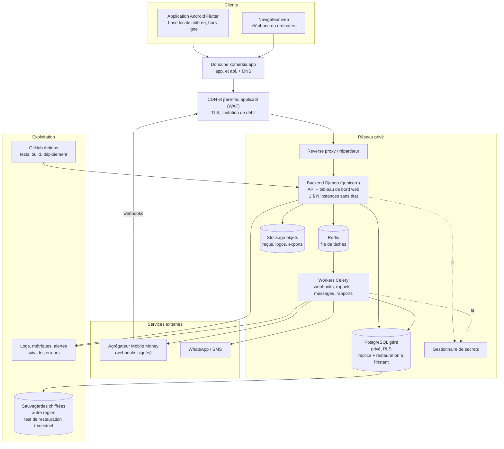

# ADR 0002 — Architecture de déploiement

- **Statut :** Proposé (à valider : hébergeur, région, budget)
- **Date :** 2026-11-17
- **Références :** cahier des charges (sections 7, 8, 20, 22, KOM-NF-003, KOM-NF-006, KOM-NF-011, KOM-NF-017), ADR 0001

## Contexte

Le schéma initial était : commerçant, domaine, application web et backend, PostgreSQL privé et géré, sauvegardes testées. Il est conservé et complété pour couvrir : l'application Android hors ligne, les webhooks Mobile Money, les tâches asynchrones, les secrets, la supervision et les environnements.

## Schéma cible

## Ce qui est ajouté au schéma initial

| Ajout | Raison |
|---|---|
| Application Android avec base locale | Vente hors ligne et synchronisation (KOM-NF-004, KOM-NF-015). Même API que le web. |
| CDN et pare-feu applicatif | TLS, limitation de débit, protection contre les abus (KOM-NF-006, KOM-NF-018). |
| Entrée dédiée aux webhooks Mobile Money | Ils doivent passer par le même contrôle, être vérifiés par signature et traités de façon idempotente (section 18.6). |
| Workers Celery et Redis | Les tâches longues et les appels externes ne bloquent pas l'API. |
| Instances de backend sans état | Mise à l'échelle horizontale et déploiement sans interruption. |
| Base PostgreSQL avec restauration à l'instant | Objectif de perte de données de 15 minutes (KOM-NF-017). Une sauvegarde quotidienne seule ne suffit pas. |
| Sauvegardes dans une autre région | Protection contre la perte d'un site. |
| Stockage objets | Reçus, logos et exports hors de la base. |
| Gestionnaire de secrets | Aucun secret dans le code (section 7). |
| Supervision | Alertes sur erreurs, latence, échecs de synchronisation et de paiement (KOM-NF-021). |
| Trois environnements | Développement, test, production, séparés (section 8.3). |

## Règles de sécurité

1. La base de données n'a **aucune adresse publique** : seules les instances du backend et des workers y accèdent.
2. Le backend se connecte avec le rôle applicatif non propriétaire ; les migrations s'exécutent avec le rôle propriétaire, depuis la CI ou un job dédié.
3. Chiffrement en transit (TLS partout) et au repos (base, stockage objets, sauvegardes).
4. Accès humains à la production : comptes nominatifs, double authentification, journalisés. Pas de mot de passe partagé.
5. Les sauvegardes sont chiffrées, et leur restauration est testée chaque trimestre.

## Environnements

| Environnement | Usage | Données |
|---|---|---|
| Développement | Poste local ou Docker Compose | Fictives |
| Test (staging) | Recette et démonstration aux pilotes | Fictives, jamais de copie de production |
| Production | Commerçants réels | Réelles, sauvegardées |

## Décisions encore ouvertes

| Sujet | Options | Critères |
|---|---|---|
| Hébergeur | Fournisseur européen, africain ou grand cloud | Latence depuis la RDC, localisation des données (section 20), PostgreSQL géré avec restauration à l'instant, coût mensuel |
| Région | Europe, Afrique du Sud ou autre | Latence mesurée depuis Kinshasa et Lubumbashi avant de choisir |
| Mode de déploiement | Conteneurs sur plateforme gérée, ou machines virtuelles avec Docker | Équipe réduite : privilégier le moins d'exploitation possible |
| Agrégateur Mobile Money | À choisir | Couverture RDC, agrément, frais, qualité des webhooks |
| Budget d'infrastructure | À fixer | Le plan Essentiel à 5 USD par mois impose des coûts par commerçant très faibles |

## Phasage conseillé

- **Pilote (M1) :** une instance de backend, un PostgreSQL géré avec sauvegardes et restauration à l'instant, supervision de base. Pas de réplica ni de worker séparé si le volume est faible.
- **Lancement commercial (M2) :** workers et Redis, WAF, deuxième instance, sauvegardes dans une autre région, alertes complètes.
- **Croissance :** réplica de lecture pour les rapports, mise à l'échelle des workers, revue de l'architecture quand le volume l'exige.
